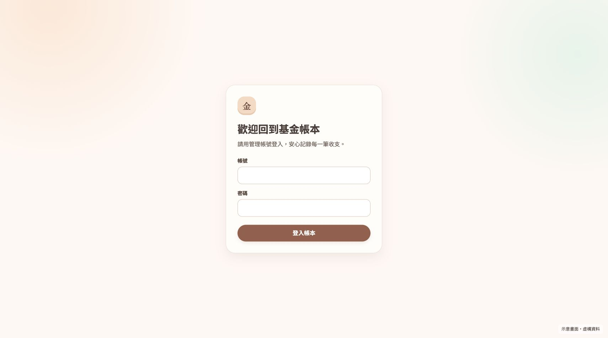
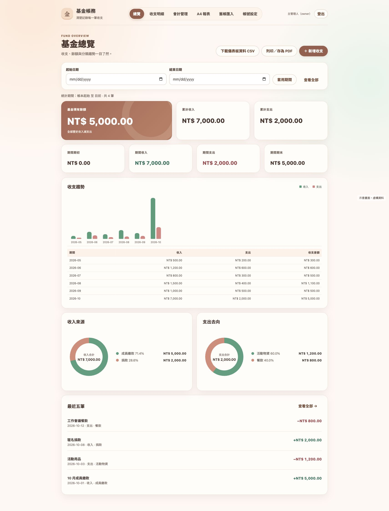
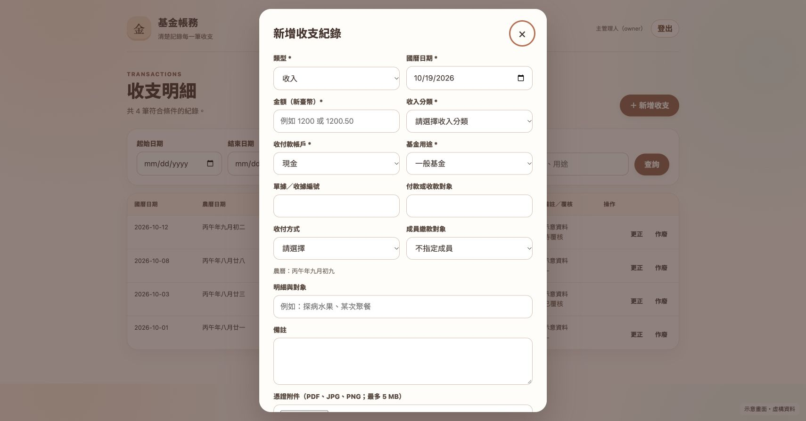
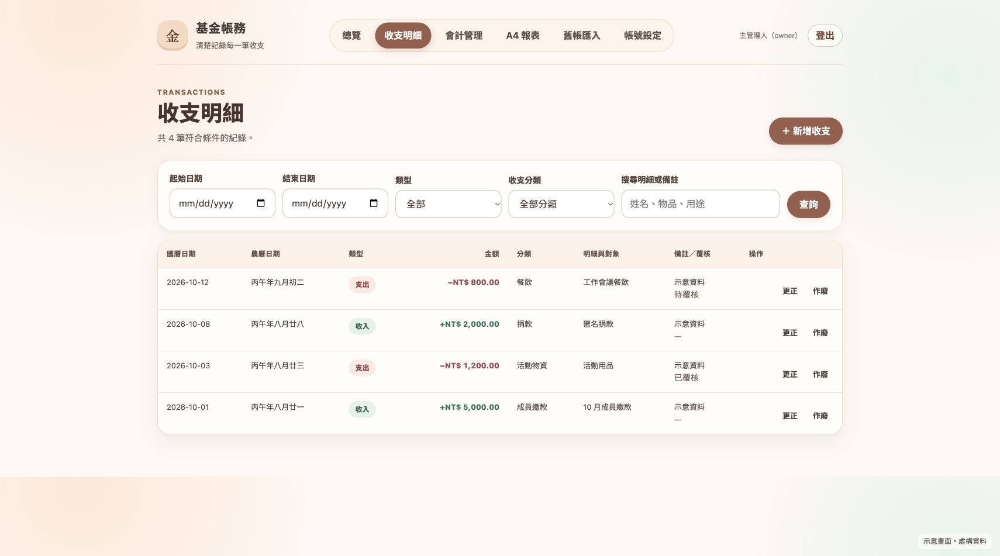
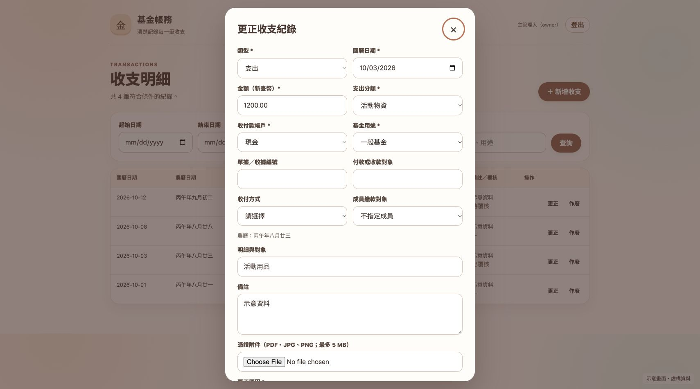
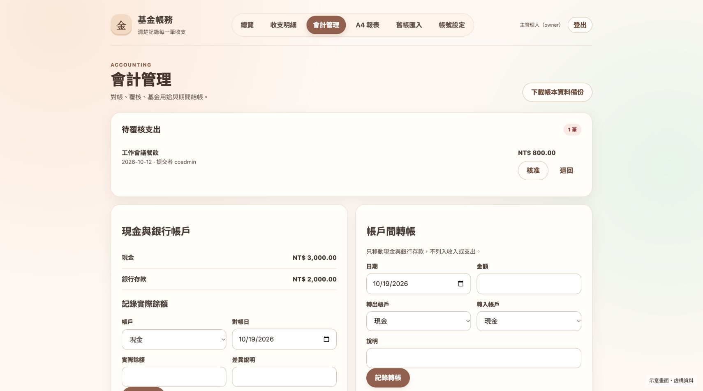
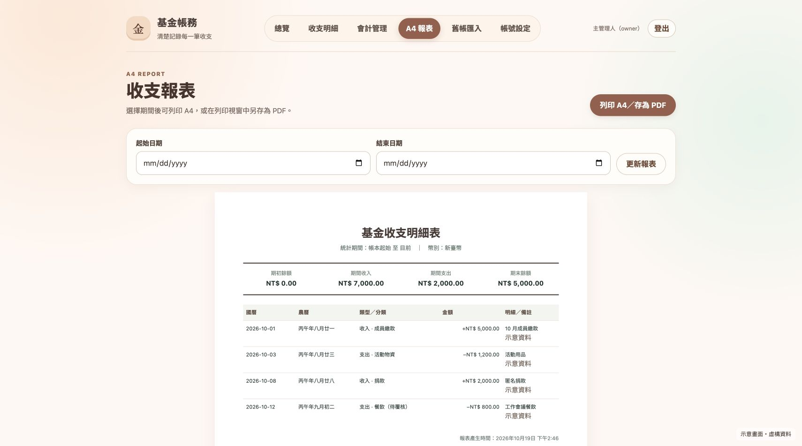
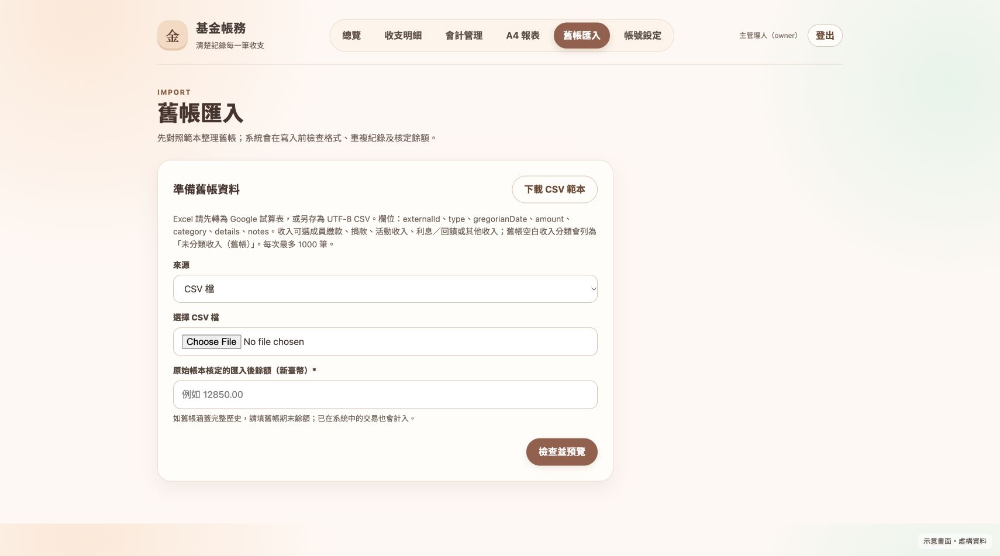

# 基金帳務管理系統｜使用手冊

> **數位敘事力期刊開源提供應用。** 本手冊可隨公開程式一起分享；轉載或修改時，請保留「數位敘事力期刊開源提供應用」的來源說明。
>
> 本頁截圖使用目前公開版介面與**虛構示意資料**製作，並非任何人的真實帳本。畫面文字與按鈕可能隨版本略有變動。安裝系統請先看 [README 的兩種安裝方式](../README.md#安裝前先選一條路)。

## 一分鐘認識系統

上方選單依序是「總覽、收支明細、會計管理、A4 報表、舊帳匯入、帳號設定」。平常可依照 **登入 → 新增收支 → 另一人覆核支出 → 對帳 → 看報表與備份** 的順序使用。金額皆為新臺幣，收入與支出分開顯示；系統以「收入減支出」計算基金餘額。

## 1. 登入

1. 打開部署後取得的網站網址。
2. 輸入管理帳號與自己設定的密碼，按「登入帳本」。主管理人帳號是 `owner`，共同管理人帳號是 `coadmin`。
3. 第一次使用時，請先由 `owner` 登入。系統會建立這個部署專用的帳本試算表與備份資料夾。

登入有效期約六小時。若顯示登入到期，重新登入即可。密碼不要寫在報表或和網站網址一起公開分享。

## 2. 看懂基金總覽與儀表板

- **基金現有餘額**：從帳本開始到現在的全部收入減支出。
- **期間期初／收入／支出／期末**：只看你選的日期區間。先選起始與結束日期，再按「套用期間」；按「查看全部」可清除期間。
- **收支趨勢與分類圖**：看每月收支和錢的來源、去向。圖表旁同時有金額和比例。
- **下載儀表板資料 CSV**：把目前儀表板的統計資料下載到電腦；「列印／存為 PDF」可產生可分享的畫面。
- **最近五筆**：快速看最新紀錄；按「查看全部」進入收支明細。

圖中的金額是示意數字，不是實際基金資料。

## 3. 新增收入或支出

從總覽或收支明細按「＋ 新增收支」。

1. 選「收入」或「支出」，再選國曆日期；畫面會自動顯示農曆。
2. 輸入金額，從下拉選單選對應分類。收入與支出有不同的分類清單。
3. 選收付款帳戶與基金用途；有單據編號、收付款對象或收付方式時一起填入。
4. 在「明細與對象」寫清楚用途，必要時補上備註。若有憑證，可選 PDF、JPG 或 PNG 檔，單檔最多 5 MB。
5. 檢查資料後捲到表單底部，按「儲存紀錄」。支出儲存後，請另一位管理人到「會計管理」覆核。

建議明細寫「活動用品」這種能理解用途的文字；涉及個人情況時，只記錄帳務所需資訊。

## 4. 查詢、更正或作廢

在「收支明細」可用日期、類型、收支分類及關鍵字縮小範圍，填好後按「查詢」。桌面版每筆資料右邊有「更正」「作廢」按鈕；手機版以卡片顯示。

資料輸入錯誤時按「更正」，修改欄位並在表單底部填寫**更正原因**後儲存。若整筆不應計入，按「作廢」，填寫原因並確認。系統會保留操作前後紀錄，餘額和報表也會重新計算。請避免直接改動底層 Google 試算表。

## 5. 覆核、對帳、轉帳與結帳

進入「會計管理」後，先看「待覆核支出」。**提交支出的帳號不能自行核准同一筆**；請另一位管理人核對明細與憑證後按「核准」，或填原因「退回」。

頁面往下還可以：

- 在「現金與銀行帳戶」選帳戶和對帳日，輸入實際餘額，查看差異。
- 在「帳戶間轉帳」記錄現金與銀行存款之間的移動；這筆移動不算新的收入或支出。
- 查看或設定基金用途、成員繳款及支出預算。
- 由主管理人在月末完成期間結帳。結帳前要處理所有待覆核支出，並完成各帳戶零差異對帳；結帳後，該期間的交易會受到鎖定。

主管理人也可在此按「下載帳本資料備份」，將資料另存到自己的安全位置。系統的每日備份則位於部署者的 Google Drive。下載資料檔**不含憑證原檔**，憑證資料夾須另外保存。

## 6. 列印 A4 收支報表

1. 按上方「A4 報表」。若只需某段時間，選起始與結束日期，按「更新報表」。
2. 核對期初餘額、期間收入、期間支出、期末餘額及逐筆明細。
3. 按「列印 A4／存為 PDF」。在瀏覽器列印視窗選印表機，或選「另存為 PDF」。

報表可能包含對象、用途與備註；分享給成員前請確認接收對象與內容。

## 7. 匯入以前的帳本

1. 按「舊帳匯入 → 下載 CSV 範本」，照範本整理資料。也可選 Google 試算表作為來源。
2. 填入**原帳本核定的匯入後餘額**，選檔案或貼上試算表網址，按「檢查並預覽」。
3. 仔細核對預覽的筆數、收入、支出、預計餘額和錯誤訊息。只有檢查及餘額核對都通過，才按「確認匯入」。

初次正式匯入前，請另外核對原始帳本的總收入、總支出和期末餘額。匯入過程若有格式或重複錯誤，先修正來源資料，不要跳過檢查。

## 8. 更換密碼與共同管理人帳號

在「帳號設定」輸入目前密碼與新密碼，就能更新自己的密碼。主管理人還能重設共同管理人的密碼，或停用／啟用共同管理人帳號。新密碼至少 16 個字元；更換後請重新登入。

## 使用前最後檢查

- [ ] `owner` 和 `coadmin` 都能登入，且各自保管自己的密碼。
- [ ] 虛構收入、支出能儲存；支出可由另一人覆核。
- [ ] 總覽餘額與收支明細一致，A4 報表可閱讀。
- [ ] 對帳差異已處理，備份檔及憑證資料夾可找到。
- [ ] 正式舊帳匯入後，總收入、總支出與期末餘額都和原帳本一致。

---

**數位敘事力期刊開源提供應用。** 若你依本手冊改作其他團體的帳務系統，請先用虛構資料演練，再決定如何保護成員資料與分享報表。
